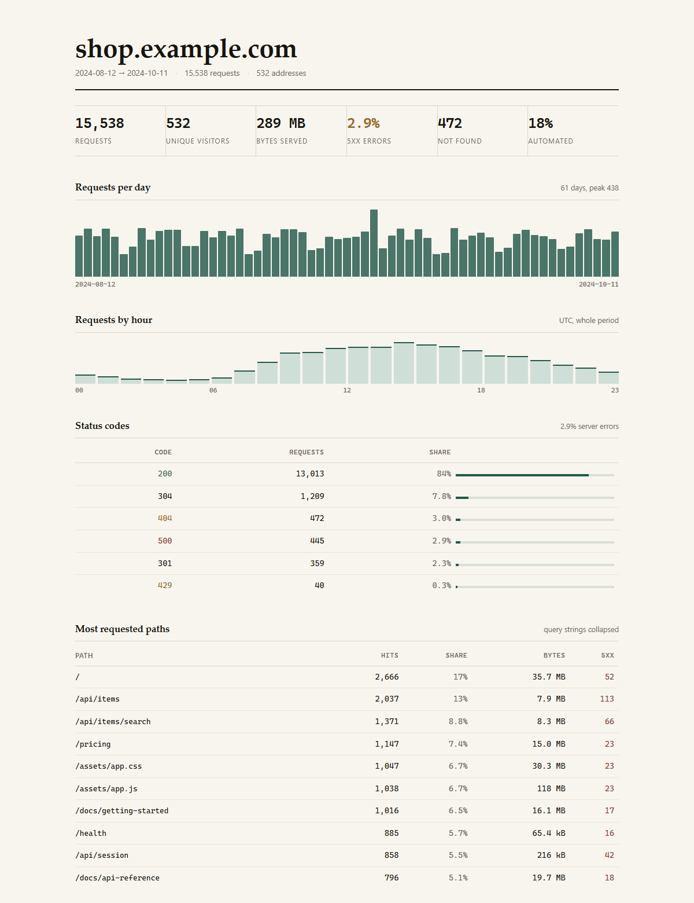

# logdigest

**Turn a web-server access log into one self-contained HTML report.**

   



Point it at an nginx or Apache access log and open the result: traffic per day, traffic per hour, status codes, the paths people actually request, the addresses that hammer you, which clients they use, and where they came from. One HTML file, no JavaScript, no fonts to fetch, no network calls.

## Why

`grep` gives you lines. `awk` gives you numbers you have to trust. Hosted analytics wants your logs uploaded somewhere and an account.

This is the middle path: one command, one portable file. Print it, email it, attach it to a ticket, open it on a plane. Parsing, counting and rendering all happen on your machine; nothing leaves it.

## Install

Node 18 or newer, nothing else.

```sh
git clone https://github.com/wangtianbao-debug/logdigest.git
cd logdigest
npm link            # optional: puts `logdigest` on your PATH
```

Without `npm link`, run it as `node bin/logdigest.js`.

## Usage

```sh
logdigest access.log                       # writes access.html next to the log
logdigest access.log -o report.html        # choose the output path
logdigest access.log -o -                  # write the HTML to stdout
zcat access.log.*.gz | logdigest -         # read from stdin
logdigest access.log --top 20              # longer tables
logdigest access.log --since 2024-10-01 --until 2024-10-07
logdigest access.log --json                # the numbers, not the picture
```

| Option | Meaning |
| --- | --- |
| `-o, --out <path>` | Output path, or `-` for stdout. Default: the log's name with `.html`. |
| `--top <n>` | Rows per table (default 10). |
| `--json` | Print the computed statistics as JSON instead of HTML. |
| `--title <name>` | Report title. Default: the log file name. |
| `--since <date>` | Drop entries before this UTC day. |
| `--until <date>` | Drop entries after this UTC day (the whole day is included). |
| `-q, --quiet` | Print nothing on success. |
| `-h, --help` | Usage. |
| `-v, --version` | Version. |

## What the report contains

| Section | What it answers |
| --- | --- |
| Summary strip | Requests, unique addresses, bytes served, 5xx rate, 404s, share of automated traffic. |
| Requests per day | Daily traffic with the peak marked; the shape of a launch, an outage or a weekend. |
| Requests by hour | UTC histogram of the whole period: when the day actually happens. |
| Status codes | Every status served, with share bars, coloured by class. |
| Most requested paths | Top paths by hits with bytes and 5xx counts. Query strings are collapsed, so `/search?q=a` and `/search?q=b` are the same endpoint. |
| Busiest addresses | Top client addresses and their share of all requests. |
| Clients | User agents folded into families (Chrome, Safari, Firefox, Edge, curl, Googlebot…) plus the automated share. |
| Referrers | Where the traffic came from. |

Timestamps are UTC everywhere, so a report generated in Shanghai and one generated in Berlin agree. A `-` byte count (304s, HEADs, aborted transfers) counts as 0 bytes but still counts as a request.

## Log formats

- **combined** — the nginx default: `$remote_addr - $remote_user [$time_local] "$request" $status $body_bytes_sent "$http_referer" "$http_user_agent"`.
- **common** — the same without referer and user agent.
- Extra trailing fields are ignored, so `log_format` additions (`$request_time`, `$upstream_addr`, `$http_x_forwarded_for`) are harmless:

  ```nginx
  log_format main '$remote_addr - $remote_user [$time_local] "$request" '
                  '$status $body_bytes_sent "$http_referer" "$http_user_agent" '
                  '$request_time $upstream_response_time';
  ```

- `access.log.gz` is decompressed on the fly, so rotated logs need no `zcat`.
- Lines that are not access-log entries are counted as skipped and reported in the footer — your log can have startup banners in it.

## Exit codes

| Code | Meaning |
| --- | --- |
| 0 | Report written. |
| 1 | The log could not be read, held no entries, or every entry fell outside `--since`/`--until`. |
| 2 | Bad usage. |

## Use it as a library

```js
import { parseLog, computeStats, renderHtml } from 'logdigest';
import { readFileSync, writeFileSync } from 'node:fs';

const { entries, skipped } = parseLog(readFileSync('access.log', 'utf8'));
const stats = computeStats(entries, { top: 20 });

writeFileSync('report.html', renderHtml({ name: 'api.example.com', stats, skipped }));
console.log(stats.topPaths[0]);   // { path: '/', hits: 266, share: 0.17, bytes: 3742891, errors: 3 }
```

`computeStats` returns plain data — no DOM, no strings to scrape — so it also works in a test, a Worker or a build step.

## Performance

Parsing is a single regex per line and one pass of counters. A 620,000-line combined log (117 MB) parses and renders in **2.3 s** on a laptop with Node 24, and the resulting HTML is under 20 kB because the report is aggregates, not rows.

## Limits

- One file at a time; concatenate rotated logs first (`cat access.log.* | logdigest -`).
- UTC only — the log's own offset is honoured when parsing, but the report bins by UTC.
- No geolocation, no sessions, no revenue; this is traffic shape, not an analytics product.
- Bot detection is a curated pattern list, not a classifier.
- Fields are parsed positionally for the two standard formats; exotic `log_format` layouts need a reordering first.

## Tests

```sh
node --test
```

41 tests cover date parsing (including negative offsets), combined vs common lines, extra trailing fields, escaping of hostile paths and user agents, the statistics, and the CLI end to end (default output path, `-o -`, gzip, `--since/--until`, exit codes).

## CI

The workflow lives at [`ci/ci.yml`](ci/ci.yml) — copy it to `.github/workflows/ci.yml` to run the matrix (Ubuntu, Windows, macOS × Node 18/20/22/24).

## License

MIT © 2026 wangtianbao-debug
